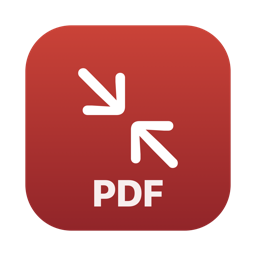
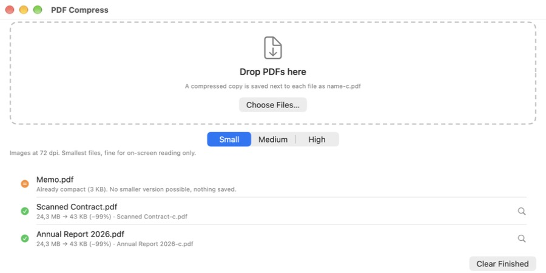

<p align="center">
  
</p>

<h1 align="center">PDF Compress</h1>

<p align="center">
  A tiny native macOS app that shrinks PDFs with Ghostscript.<br>
  Drop files in, get a compressed copy next to each original.
</p>

<p align="center">
  
</p>

## Features

- **Drag and drop.** Drop PDFs on the window or on the app icon in the Dock or Finder, or click **Choose Files…**. *Open With → PDF Compress* in Finder works too.
- **Originals stay untouched.** The compressed copy is saved next to the original as `name-c.pdf`.
- **Never overwrites.** If `name-c.pdf` already exists, the new copy is saved as `name-c 2.pdf`, `name-c 3.pdf`, and so on.
- **No pointless copies.** If Ghostscript can't make a file smaller, nothing is saved and the app tells you so.
- **Three quality levels.**

  | Setting | Ghostscript preset | Image resolution | Good for |
  |---|---|---|---|
  | Small | `/screen` | 72 dpi | On-screen reading, smallest files |
  | Medium (default) | `/ebook` | 150 dpi | Sharing and reading |
  | High | `/printer` | 300 dpi | Printing |

- **Handles any file name.** Spaces, umlauts and `%` all work.
- **Batch processing.** Two files are compressed in parallel. Each row shows the size before and after, and a button reveals the result in Finder.
- **Native and small.** Written in SwiftUI with no dependencies besides Ghostscript. The app is under 1 MB and runs natively on Apple silicon.

## Requirements

- macOS 14 (Sonoma) or later on Apple silicon
- [Ghostscript](https://www.ghostscript.com), installed with [Homebrew](https://brew.sh):
  ```bash
  brew install ghostscript
  ```
- To build: Xcode or the Xcode Command Line Tools (`xcode-select --install`)

## Build and install

```bash
git clone https://github.com/eliasgruenewald/pdf-compress.git
cd pdf-compress
./build.sh
```

`build.sh` compiles the app, generates its icon, ad-hoc signs it and installs it as `/Applications/PDF Compress.app`, replacing any previous version. The intermediate build lives in `build/`.

Because you built the app yourself, it's not quarantined and opens without a Gatekeeper warning. The first time you compress a file in Desktop, Documents or a cloud folder, macOS may ask whether PDF Compress may access that folder.

## How it works

For each file, the app runs:

```bash
gs -dSAFER -dBATCH -dNOPAUSE -dQUIET -sDEVICE=pdfwrite \
   -dCompatibilityLevel=1.5 -dPDFSETTINGS=/ebook \
   -sOutputFile=<temp file> <input.pdf>
```

- **Temporary output.** Ghostscript writes to a temporary file first. Only when it succeeds and the result is smaller is the file moved next to the original. A failed run never leaves a half-written file beside your PDF.
- **`%` in file names.** Ghostscript treats `%` in an output name as a page-number pattern. Writing to a temporary file first means names containing `%` still work.
- **Finding Ghostscript.** Apps started from Finder don't get your shell's `PATH`, so the app looks for `gs` in `/opt/homebrew/bin` and then `/usr/local/bin`.

Compression works best on PDFs with large images, such as scans and photo-heavy documents. Text-only PDFs that are already optimized often can't get any smaller.

## Project layout

| File | Purpose |
|---|---|
| `main.swift` | The whole app: UI, job queue, Ghostscript call |
| `Info.plist` | Bundle metadata; registers the app as an *alternate* PDF handler so the icon accepts drops (it never becomes your default PDF viewer) |
| `icon.swift` | Renders the app icon |
| `build.sh` | Builds, signs and installs the app |

## Uninstall

```bash
rm -rf "/Applications/PDF Compress.app"
defaults delete local.pdfcompress   # removes saved settings (quality, window position)
```

## Notes

Ghostscript is a separate program, licensed under the AGPL by Artifex. PDF Compress doesn't include it; it calls the `gs` you installed.
